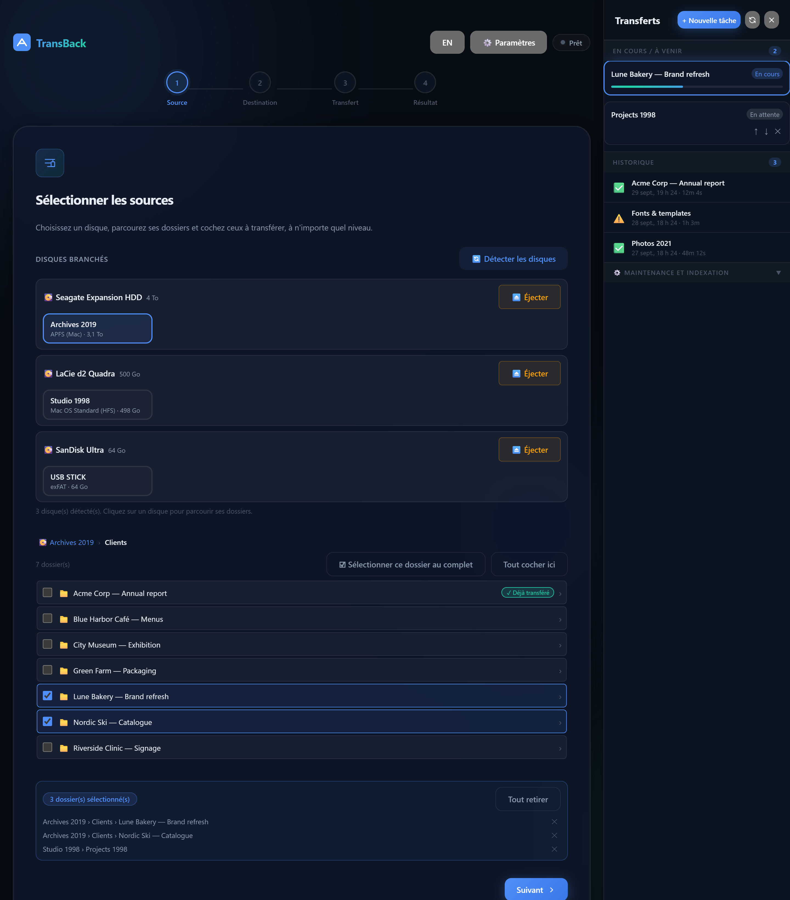

<div align="center">

# TransBack

**Copier des disques USB dans Nextcloud — ou dans n'importe quel dossier — depuis une page web.**
Vieux disques Mac compris.

[Fonctionnalités](#fonctionnalités) • [Installation](#installation) • [Sécurité](#sécurité) • 🇬🇧 [English](README.md)



</div>

---

TransBack est une petite application web auto-hébergée pour transférer le contenu de disques externes dans **Nextcloud** (ou dans n'importe quel dossier du serveur) **sans ligne de commande** : on branche le disque sur le serveur, on coche les dossiers dans le navigateur, on choisit la destination, et TransBack copie, corrige et indexe le tout, avec la progression en direct.

Elle a été créée pour verser plus de 20 ans d'archives d'une agence de design (disques Mac de 1998 à aujourd'hui) dans Nextcloud, et pensée pour des personnes non techniques.

## Fonctionnalités

- **Lit presque tous les disques, en lecture seule** : APFS (Mac récents, via [apfs-fuse](https://github.com/sgan81/apfs-fuse)), Mac OS étendu (HFS+), Mac OS standard (HFS, années 90, noms convertis depuis MacRoman), FAT32, exFAT, NTFS, CD/DVD (ISO 9660, UDF), ext2/3/4, btrfs, XFS.
- **Simple** : navigation à n'importe quelle profondeur, sélection sur plusieurs niveaux et plusieurs disques, destinations **par nom** (dossiers de groupe, dossiers personnels ou simples dossiers), file d'attente avec pause, reprise et annulation, historique, bouton ⏏️ Éjecter.
- **Résultat propre** : bon propriétaire et droits configurables, accents des Mac convertis en NFC (sans doublon à la relance), fichiers système ignorés, indexation Nextcloud limitée aux dossiers copiés, anciens fichiers Mac à « branche de ressources » signalés.
- **Sûre et autonome** : contrôle de l'espace libre, détection des transferts bloqués, webhook de fin (ntfy, Discord, Slack, n8n…), détection automatique de Nextcloud avec un onglet **Diagnostic**, mot de passe ou proxy d'authentification optionnels.
- Interface en français et en anglais, sur ordinateur et mobile.

## Prérequis

- Un hôte **Linux** avec **Docker** (NAS ou serveur, x86-64 ou ARM64). Docker Desktop sous Windows ou macOS ne voit pas les disques USB.
- Pour les destinations Nextcloud : **Nextcloud en Docker** sur le même hôte (image officielle, linuxserver.io ou AIO).
- Sans Nextcloud : il suffit de monter les dossiers de destination (voir plus bas).

| Installation | État |
|---|---|
| NAS Ugreen (UGOS) + image Nextcloud officielle | ✅ utilisé en production |
| Image officielle, données dans un volume nommé | ✅ testé |
| Image linuxserver.io | ✅ testé |
| Simples dossiers, sans Nextcloud | ✅ testé |
| Nextcloud AIO, Synology, QNAP, TrueNAS SCALE, Unraid, OpenMediaVault, Raspberry Pi | 🟡 devrait fonctionner, pas encore testé |

## Installation

1. Créez un `docker-compose.yml` à partir de [celui du README anglais](README.md#install) ou d'un exemple de [`examples/`](examples/). Montez le dossier de données de Nextcloud **au même chemin** que sur l'hôte, et définissez `TB_PASSWORD` et `TB_LANG: fr`.
2. `docker compose up -d`
3. Ouvrez `http://<serveur>:3000`, puis **⚙️ Paramètres › Diagnostic** : tout est détecté automatiquement, et s'il manque quelque chose, la ligne exacte à ajouter est affichée en rouge.
4. Branchez un disque, cliquez sur **Détecter les disques**, c'est parti.

Mise à jour : `docker compose pull && docker compose up -d`.

### Sans Nextcloud (simples dossiers)

Montez un ou plusieurs dossiers sous `/destinations` : chacun devient une destination. Les fichiers prennent le propriétaire de ce dossier et rien n'est indexé ; le socket Docker devient optionnel.

```yaml
    volumes:
      - /dev:/dev
      - /lib/modules:/lib/modules:ro
      - ./transback-data:/app/data
      - /srv/archives:/destinations/Archives
```

La liste complète des variables d'environnement est dans le [README anglais](README.md#configuration).

## Sécurité

TransBack est un outil d'administration : il utilise le socket Docker et tourne en mode `privileged`, donc **toute personne qui peut l'utiliser peut contrôler l'hôte**. Gardez-le sur votre réseau interne ou derrière une authentification, et définissez `TB_PASSWORD`. Les disques sources sont toujours montés en lecture seule. Détails : [SECURITY.md](SECURITY.md).

## Licence

[MIT](LICENSE) © Gabriel Maltais
