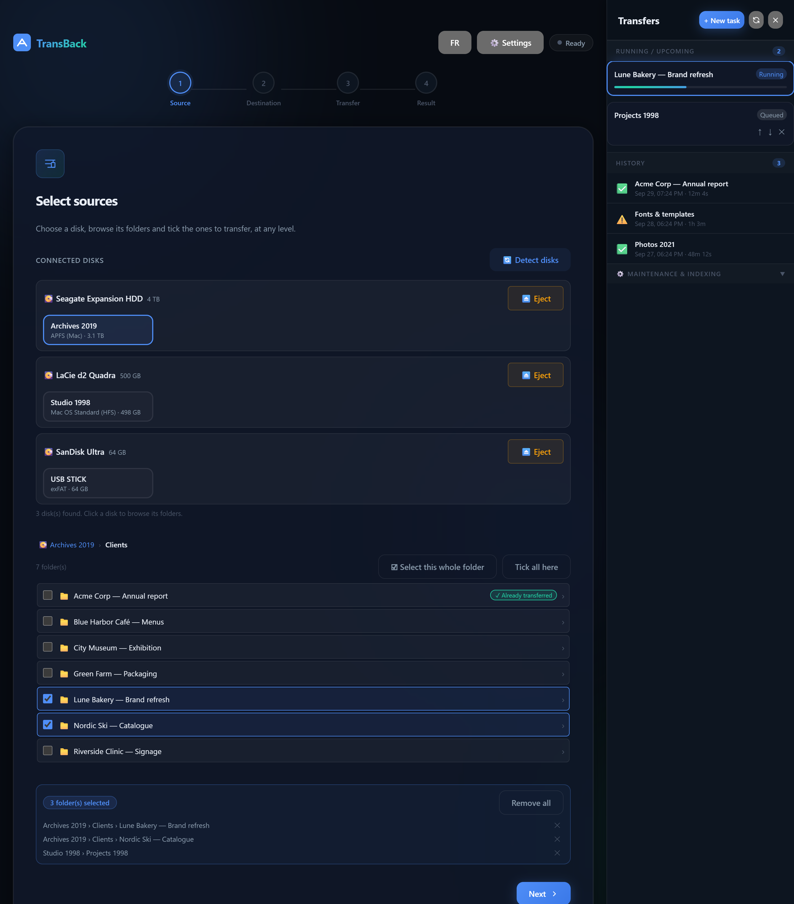
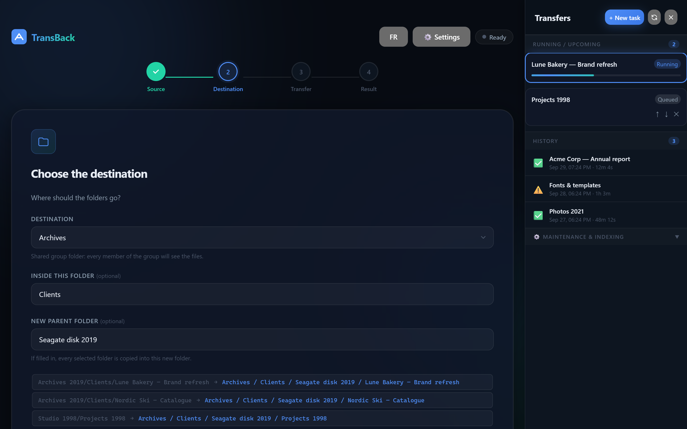
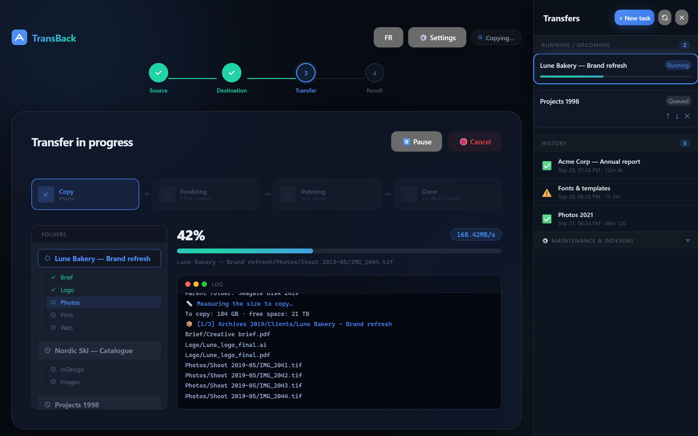
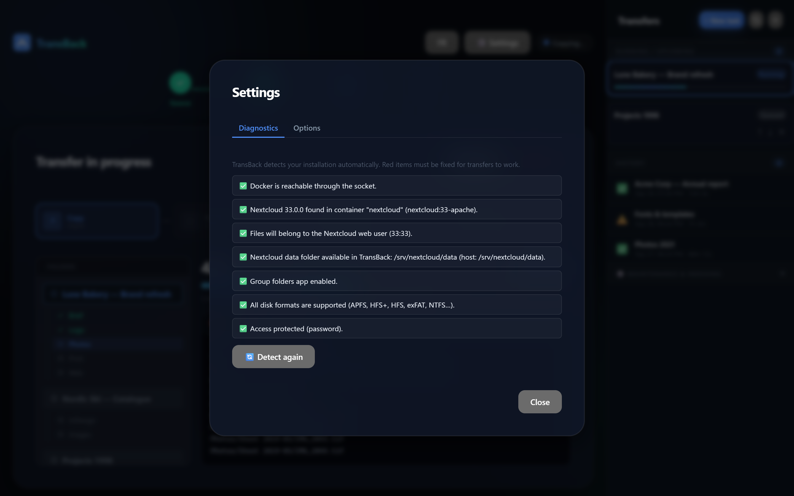
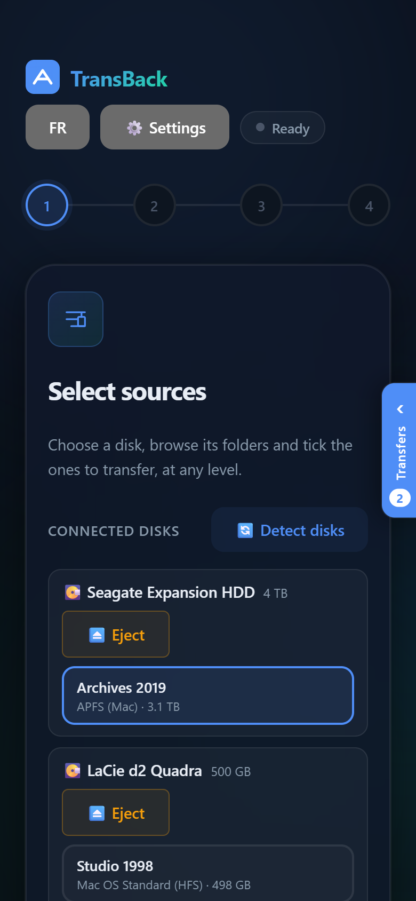

<div align="center">

# TransBack

**Copy USB disks into Nextcloud — or any folder — from a web page.**
Old Mac disks included.

[](https://github.com/gabrielmaltais/transback/actions/workflows/ci.yml)
[](https://github.com/gabrielmaltais/transback/releases)
[](https://github.com/gabrielmaltais/transback/pkgs/container/transback)
[](LICENSE)


[Features](#features) • [Install](#install) • [Configuration](#configuration) • [Security](#security) • [FAQ](#faq) • 🇫🇷 [Français](README.fr.md)



</div>

---

TransBack is a small self-hosted web app to move the content of external disks into **Nextcloud** (or into any folder of your server) **without a terminal**: plug the disk into the server, tick the folders in the browser, pick the destination, and TransBack copies, fixes and indexes everything — while you watch the progress.

It was built to move 20+ years of design-agency archives — Mac disks from 1998 to today — into Nextcloud, and it is meant to be used by non-technical staff.

## Features

**Reads almost any disk, read-only**
- APFS (modern Mac, via [apfs-fuse](https://github.com/sgan81/apfs-fuse)), Mac OS Extended (HFS+), Mac OS Standard (HFS, 1990s — names converted from MacRoman)
- FAT32, exFAT, NTFS, CD/DVD (ISO 9660, UDF), ext2/3/4, btrfs, XFS
- Disks shown by their name, per-disk ⏏️ **Eject** button (refused while a transfer uses the disk)

**Simple for everyone**
- Folder browser at any depth; tick folders from different levels and disks, the selection is kept while you browse
- Destinations chosen **by name**: Nextcloud group folders, users' personal folders, or plain folders
- Queue with pause / resume / cancel, live progress and log, history showing which folders were already transferred
- English and French, works on desktop and mobile

**A clean result**
- Files owned by the right user with configurable permissions
- Mac accented names converted to NFC (no duplicates when a transfer is run again)
- macOS / Windows junk skipped (`.DS_Store`, `._*`, `Icon\r`, `Thumbs.db`…); symbolic links never followed
- Nextcloud indexing limited to the copied folders (`occ files:scan` / `groupfolders:scan --path`)
- Old Mac files whose whole content lives in the *resource fork* (suitcase fonts, 1990s documents) are listed in the report

**Safe and self-adapting**
- Free space checked before copying, stuck transfers detected, webhook notification at the end (ntfy, Discord, Slack, n8n…)
- Finds the Nextcloud container, `occ`, the web user and the data folder **by itself**; a **Diagnostics** tab tells you exactly what to fix
- Optional password or reverse-proxy authentication

<table>
  <tr>
    <td></td>
    <td></td>
  </tr>
  <tr>
    <td align="center"><sub>Destination by name</sub></td>
    <td align="center"><sub>Live progress and log</sub></td>
  </tr>
  <tr>
    <td></td>
    <td align="center"></td>
  </tr>
  <tr>
    <td align="center"><sub>Automatic diagnostics</sub></td>
    <td align="center"><sub>Mobile</sub></td>
  </tr>
</table>

## Requirements

- A **Linux** host with **Docker** — NAS or server, x86-64 or ARM64. *(Docker Desktop on Windows/macOS cannot see USB disks.)*
- For Nextcloud destinations: **Nextcloud running in Docker** on the same host (official image, linuxserver.io or AIO). The **Group folders** app is optional.
- Without Nextcloud: just mount the folders you want to copy to (see [plain folders](#without-nextcloud-plain-folders)).

| Setup | Status |
|---|---|
| Ugreen NAS (UGOS) + official Nextcloud image | ✅ used in production |
| Official Nextcloud image, data in a named volume | ✅ tested |
| linuxserver.io Nextcloud image | ✅ tested |
| Plain folders, without Nextcloud | ✅ tested |
| Nextcloud AIO, Synology, QNAP, TrueNAS SCALE, Unraid, OpenMediaVault, Raspberry Pi | 🟡 should work, not tested yet — [feedback welcome](https://github.com/gabrielmaltais/transback/issues) |

## Install

**1. Create a `docker-compose.yml`** (ready-made versions for [Ugreen](examples/ugreen-nas.yml), [Synology](examples/synology.yml), [Nextcloud AIO](examples/nextcloud-aio.yml) and [linuxserver.io](examples/linuxserver.yml) are in [`examples/`](examples/)):

```yaml
services:
  transback:
    image: ghcr.io/gabrielmaltais/transback:latest
    container_name: transback
    restart: unless-stopped
    privileged: true          # to mount USB disks — see Security
    ports:
      - "3000:3000"
    environment:
      TB_PASSWORD: change-me  # recommended
      TB_LANG: en             # language of task logs: en | fr
    volumes:
      - /var/run/docker.sock:/var/run/docker.sock   # to talk to the Nextcloud container
      - /dev:/dev
      - /lib/modules:/lib/modules:ro
      - ./transback-data:/app/data
      # Your Nextcloud data folder, at the SAME path as on the host:
      - /srv/nextcloud/data:/srv/nextcloud/data
```

**2. Start it:**

```bash
docker compose up -d
```

**3. Open `http://<your-server>:3000`**, then **⚙️ Settings › Diagnostics**. Everything is detected automatically; if something is missing (for example the data folder volume), the exact line to add is shown in red.

**4. Plug in a disk**, click **Detect disks**, and go.

To update: `docker compose pull && docker compose up -d`.

### Without Nextcloud (plain folders)

Mount one or more folders under `/destinations`; each one becomes a destination. Files are copied with the owner of that folder and nothing is indexed. The Docker socket is then optional.

```yaml
    volumes:
      - /dev:/dev
      - /lib/modules:/lib/modules:ro
      - ./transback-data:/app/data
      - /srv/archives:/destinations/Archives
      - /srv/photos:/destinations/Photos
```

## Configuration

Most settings live in **⚙️ Settings › Options**: default destination, permissions, speed limit, free-space check, webhook, excluded files. Environment variables set the defaults:

| Variable | Default | Description |
|---|---|---|
| `TB_PASSWORD` | — | Ask for this password (session cookie) |
| `TB_TRUST_PROXY_AUTH` | — | Trust an authenticating proxy: name of the header it sets (e.g. `Cf-Access-Authenticated-User-Email`, `Remote-User`) |
| `TB_LANG` | `en` | Language of task logs and notifications (`en`, `fr`); the interface follows the browser |
| `NEXTCLOUD_CONTAINER` | auto | Nextcloud container to use, if several run on the host |
| `TB_DESTINATIONS_ROOT` | `/destinations` | Where plain-folder destinations are mounted |
| `TB_OWNER` | auto | Force the owner of copied files (`uid:gid`) |
| `TB_DIR_MODE` / `TB_FILE_MODE` | `770` / `660` | Default permissions |
| `TB_BWLIMIT` | `0` | Default speed limit in KB/s (0 = none) |
| `TB_WEBHOOK_URL` | — | Default webhook |
| `TB_CHECK_SPACE` | `1` | `0` to skip the free-space check |
| `TB_FRAME_ANCESTORS` | `'self'` | Sites allowed to embed TransBack in a frame (e.g. your Nextcloud URL) |
| `TB_WATCHDOG_MS` | `600000` | Stop rsync after this long without output nor CPU use |
| `PORT` | `3000` | HTTP port |

## Security

TransBack is an admin tool: it uses the Docker socket and runs privileged, so **anyone who can use it can control the host**. Keep it on your internal network or behind authentication, and set `TB_PASSWORD`. Source disks are always mounted read-only. Details and vulnerability reporting: [SECURITY.md](SECURITY.md).

## FAQ

**Why privileged?** Mounting disks (FUSE for APFS, kernel drivers for HFS/HFS+/exFAT…) needs it. The Docker socket already gives root-equivalent access, so it does not widen the attack surface in practice.

**My NAS already mounts USB disks.** Mount that folder read-only in the container (e.g. `/mnt/@usb` on Ugreen, `/volumeUSB1` on Synology) and TransBack reuses those mounts. Otherwise it mounts the disks itself.

**An APFS disk is encrypted (FileVault).** Not supported yet — decrypt it on a Mac first.

**What about the old Mac "resource forks"?** Linux and Nextcloud do not keep them. For most files it does not matter (icons, previews). Files whose whole content is in the resource fork (1990s suitcase fonts, some old documents) are listed in the report so you can keep the original disk for those.

**Can I copy the same folder again?** Yes: `rsync --update` only copies what changed, and accented names are merged instead of duplicated.

## How it works

1. Disks are detected with `lsblk`/`blkid` and mounted read-only in the container (or the host's mount is reused).
2. Each task runs `rsync -rtpog --update --chown --chmod` per selected folder, after checking the free space with a dry run.
3. Names are normalized to NFC (duplicates merged), then `occ` indexes the copied folders in the Nextcloud container.
4. Queue, history and settings are JSON files in `/app/data`.

## Development

```bash
npm ci
npm test               # unit tests (node:test)
PORT=3100 npm start    # the UI runs anywhere; disks and Nextcloud need Linux + Docker
```

Issues and pull requests are welcome. Please include the content of **Settings › Diagnostics** in bug reports.

## License

[MIT](LICENSE) © Gabriel Maltais
